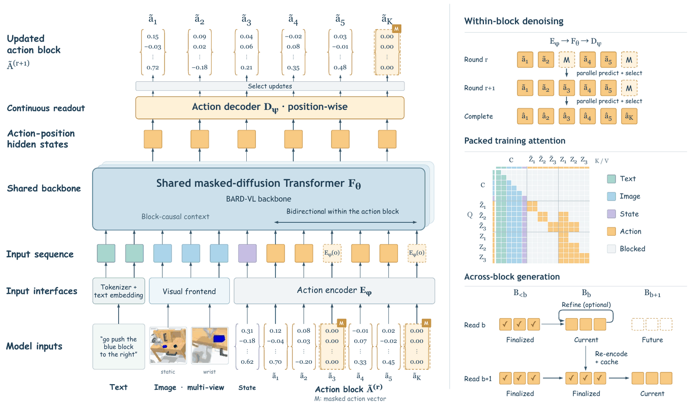

<p align="center">
  
</p>

<h1 align="center">Concertina</h1>

<p align="center"><b>Embodying Manipulation and Cognition in One Diffusion Vision-Language Model</b></p>

Concertina is an *embodied vision-language model* (eVLM). Instead of attaching an external action mechanism to a
vision-language model (an action tokenizer or a separate action expert), it places continuous trajectory
representation, blockwise generation and physical-coordinate supervision directly on the computation path of one
shared diffusion vision-language backbone ([Bard-VL](https://huggingface.co/fudan-generative-ai/Bard-VL-B4-Mask-4B-Instruct)).

This repository contains the model, the training pipeline with the paper's pretraining and fine-tuning
configurations, the released checkpoints, and the CALVIN (ABC -> D) and LIBERO evaluations. It is a
[LeRobot](https://github.com/huggingface/lerobot) policy plugin: LeRobot is used unmodified, at a pinned commit.

<p align="center">
  
</p>

## Highlights

- **One continuous latent action token per control timestep**, in the hidden space of the shared backbone. Small
  position-wise encoder and decoder projections are the only action-specific modules: no action tokenizer, codec
  or external action expert.
- **Blockwise topology.** Actions are generated in blocks that are causal across blocks and bidirectional within a
  block, by the same corrupt-and-reconstruct operator that the backbone uses for multimodal pretraining.
- **Packed teacher forcing.** All action blocks of a sample are supervised in one forward pass, directly in physical
  action coordinates, with a probability-valued gripper objective.
- **Risk-guided blockwise decoding.** Blocks are decoded over a key-value cache; a light token-risk head ranks
  proposals, and optional refinement rounds remask and re-predict low-confidence actions with the same backbone.

## Results

| Benchmark | Paper | This release, released checkpoint |
|---|---|---|
| LIBERO (Spatial / Object / Goal / Long, 4 x 500 episodes) | **98.15%** (99.0 / 100.0 / 98.8 / 94.8) | 97.80% (99.4 / 100.0 / 98.2 / 93.6) |
| CALVIN ABC -> D, average length (1000 sequences) | **4.142** | 4.153 |
| CALVIN ABC -> D, tasks completed in a row 1 / 2 / 3 / 4 / 5 | 98.6 / 93.8 / 83.2 / 73.7 / 64.9% | 98.0 / 93.0 / 83.8 / 75.1 / 65.4% |

The right column re-evaluates the released checkpoints with this code; the differences are within evaluation noise.
A LIBERO fine-tuning re-run with `concertina-train` from `concertina-pretrain-90k` reaches 97.45%.
[docs/reproduction.md](docs/reproduction.md) describes how the release was verified against the code used for the
paper, and every setting a reproduction has to match.

## Contents

- [Installation](#installation)
- [Checkpoints](#checkpoints)
- [Evaluation](#evaluation)
- [Training](#training)
- [Data](#data)
- [Repository layout](#repository-layout)
- [License](#license) / [Acknowledgements](#acknowledgements) / [Citation](#citation)

Further documentation: [evaluation](docs/eval.md), [datasets](docs/datasets.md),
[configuration](docs/configuration.md) (including the paper's ablation branches and how the paper's notation maps to
configuration fields) and [reproducing the paper results](docs/reproduction.md).

## Installation

Concertina needs Linux, Python 3.12, an NVIDIA GPU and [uv](https://docs.astral.sh/uv/). It is tested with CUDA 12.8
PyTorch wheels (NVIDIA driver >= 570.86), which also cover Blackwell GPUs. `uv` is required because LeRobot routes
`torch` and `torchcodec` to the PyTorch package indexes through `[tool.uv.sources]`, which `pip` ignores.

From a clone of this repository:

```bash
conda create -n concertina python=3.12 pip -y
conda activate concertina
uv pip install --python "$(which python)" torch==2.11.0 torchvision==0.26.0 \
    --index-url https://download.pytorch.org/whl/cu128
uv pip install --python "$(which python)" -c tools/env/constraints.txt -e ".[dev,liger]"
```

This installs LeRobot unmodified at a pinned commit, Transformers 5.5.4 and the exact package set of
`tools/env/constraints.txt` (see [tools/env/README.md](tools/env/README.md) for the full version table).

| Extra | Contents |
|---|---|
| `liger` | Liger-Kernel fused RMSNorm/RoPE/SwiGLU kernels (Linux + CUDA; `model.use_liger_kernels`, on by default) |
| `libero` | LeRobot's LIBERO simulation (hf-libero, robosuite, MuJoCo) for `concertina-eval-libero` |
| `test`, `dev` | pytest; pytest + ruff |

On headless hosts whose NVIDIA driver ships the vendor GL/EGL libraries without glvnd, importing OpenCV can fail
for lack of `libGL.so.1` / `libEGL.so.1`; install them into the environment. The data-quality tool's camera stage
also needs an `ffmpeg` binary on `PATH`:

```bash
conda install -n concertina -c conda-forge libgl libegl libopengl ffmpeg
```

Check the installation (LeRobot discovers the `concertina` policy type through its plugin mechanism):

```bash
CUDA_VISIBLE_DEVICES= pytest tests/contract
pytest tests  # the full suite; a few tests download the Qwen3-VL tokenizer or need a GPU
```

## Checkpoints

| Checkpoint | Hub id | Training |
|---|---|---|
| Concertina pretrained | `Traly/concertina-pretrain-90k` | `configs/train/pretrain_90k.yaml`: 30k more steps from the stage-1 checkpoint of `configs/train/pretrain_60k.yaml` (60k steps from the Bard-VL backbone; not released) |
| Concertina CALVIN ABC -> D | `Traly/concertina-calvin` | `configs/train/calvin.yaml`, fine-tuned from `concertina-pretrain-90k` |
| Concertina LIBERO | `Traly/concertina-libero` | `configs/train/libero.yaml`, fine-tuned from `concertina-pretrain-90k` |

A released checkpoint is a self-contained LeRobot policy directory: `config.json`, `model.safetensors` (bf16, 4.46B
parameters), the saved pre/post-processors and `backbone/` (the backbone's configuration, tokenizer and
image-processor files; all weights are in `model.safetensors`). The training and evaluation tools accept a Hub id
or a local directory. Checkpoints written by `concertina-train` refer to the backbone through `model.backbone_path`
instead.

In Python, `concertina.eval.server.load_policy(policy_path, device, inference)` returns a policy with its saved
pre/post-processors; [src/concertina/eval/libero.py](src/concertina/eval/libero.py) is a complete closed-loop example.

## Evaluation

Run the evaluation commands from the repository root (the configurations reference
`configs/eval/calvin_sequences_1000.json` by relative path). The CALVIN simulator runs in CALVIN's own environment
and talks to a Concertina policy server; `concertina-eval` starts the server and the simulation client and writes
`<run>/summary.json`. LIBERO runs in this environment. Every evaluated episode is recorded as a video by default.
[docs/eval.md](docs/eval.md) describes the simulator environments, the outputs, and what must match to reproduce the
reported numbers.

```bash
# CALVIN ABC -> D, 1000 sequences in CALVIN's sequential protocol (client environment: CALVIN's, Python 3.8)
export CALVIN_ROOT=/path/to/calvin CALVIN_DATASET=/path/to/calvin/dataset/task_ABC_D
concertina-eval --config_path configs/eval/calvin_abc_d.yaml --policy_path Traly/concertina-calvin \
    --output_dir outputs/eval/calvin --gpus '[0]'
# Faster over 3 GPUs, but not CALVIN's protocol: outcomes depend on the sequence order (see docs/eval.md)
concertina-eval --config_path configs/eval/calvin_abc_d.yaml --policy_path Traly/concertina-calvin \
    --output_dir outputs/eval/calvin_sharded --gpus '[0,1,2]' --calvin.sharded true

# LIBERO, 4 suites x 10 tasks x 50 episodes (needs the `libero` extra)
MUJOCO_GL=egl concertina-eval-libero --config_path configs/eval/libero.yaml --policy_path Traly/concertina-libero \
    --output_dir outputs/eval/libero
```

Each YAML spells out the complete decoding recipe used for the reported results of its benchmark; any field can be
overridden on the command line, for example `--server.inference.remask_steps=0` for `concertina-eval` or
`--inference.remask_steps=0` for `concertina-eval-libero`. Re-running a command with the same `--output_dir`
resumes it.

## Training

`concertina-train` is LeRobot's training loop (`lerobot-train`) with the Concertina dataset mixture and sampler: it
accepts the same arguments, and the datasets, their sampling weights and their normalization are part of the policy
configuration (`policy.data`, see [docs/configuration.md](docs/configuration.md)). `dataset.root` is the directory
that the dataset paths of `policy.data` are resolved against; `dataset.repo_id` is only a name.

The configurations in `configs/train/` are those of the paper's runs:

| Configuration | Starts from | Data | Steps x global batch |
|---|---|---|---|
| `pretrain_60k.yaml` | the Bard-VL backbone | 39 pretraining datasets (see [Data](#data)) | 60,000 x 1536 |
| `pretrain_90k.yaml` | the stage-1 checkpoint of `pretrain_60k.yaml` (not released; `--policy.pretrained_path`) | the same | 30,000 x 1536 |
| `calvin.yaml` | `Traly/concertina-pretrain-90k` | CALVIN ABC (`calvin_abc_d-lerobot`) | 5,000 x 1536 |
| `libero.yaml` | `Traly/concertina-pretrain-90k` | LIBERO (`libero`) | 5,000 x 448 |

The global batch is the per-GPU `batch_size` times 8 GPUs. The fine-tuning configurations name their parent
checkpoint by Hub id in `policy.pretrained_path`; `--policy.pretrained_path=<dir>` selects a local copy instead. In
`pretrain_90k.yaml`, `policy.pretrained_path` is a placeholder: pass the `pretrained_model` directory written by
`pretrain_60k.yaml`, `--policy.pretrained_path=<pretrain_60k output_dir>/checkpoints/last/pretrained_model`. Do not
pass `--policy.path`, which would replace the configuration's policy section with the checkpoint's.

```bash
# 8 GPUs, FSDP2 over all of them (parallelism.dp_shard: -1 in the configurations)
torchrun --nproc-per-node=8 "$(which concertina-train)" --config_path=configs/train/libero.yaml \
    --dataset.root=/path/to/datasets --output_dir=outputs/train/libero

# Resume an interrupted run (sample-exact when the GPU count and batch size are unchanged)
torchrun --nproc-per-node=8 "$(which concertina-train)" \
    --config_path=outputs/train/libero/checkpoints/last/pretrained_model/train_config.json --resume=true
```

**Fewer GPUs.** `k`-fold gradient accumulation (`accelerator.gradient_accumulation.steps`) keeps the global batch,
but LeRobot counts `steps` in micro-batches per GPU and advances the learning-rate schedule once per micro-batch.
With accumulation `k`, multiply `steps`, `policy.scheduler_warmup_steps`, `policy.scheduler_decay_steps` and
`save_freq` by `k` as well; otherwise the run makes only `steps / k` updates and its warmup and decay end `k` times
too early. Checkpoint directories are then numbered in micro-batches (at `k = 4`, `020000` is update 5,000). LIBERO
on 4 GPUs (`k = 2`, global batch 4 x 56 x 2 = 448):

```bash
torchrun --nproc-per-node=4 "$(which concertina-train)" --config_path=configs/train/libero.yaml \
    --dataset.root=/path/to/datasets --output_dir=outputs/train/libero_4gpu \
    --batch_size=56 --accelerator.gradient_accumulation.steps=2 --steps=10000 \
    --policy.scheduler_warmup_steps=160 --policy.scheduler_decay_steps=10000 --save_freq=2500
```

If memory is tight, `--policy.model.gradient_checkpointing=true` recomputes activations in the backward pass
(slower, numerically equivalent).

Training stores the parameters in fp32 and computes in bf16 (`policy.dtype: float32`,
`accelerator.mixed_precision: bf16` in every configuration); bf16 parameter storage would lose most updates to
rounding (see [docs/configuration.md](docs/configuration.md#precision)). The training-step counter that keys
Concertina's per-sample training randomness restarts at 0 when fine-tuning from a checkpoint and continues when
resuming. Checkpoints are written to `<output_dir>/checkpoints/<step>/pretrained_model` and can be evaluated
directly.

## Data

Concertina trains on local [LeRobot v3](https://huggingface.co/docs/lerobot/lerobot-dataset-v3) datasets. Each
dataset of the mixture names its source schema (`droid`, `agibot`, `robomind`, `libero` or `calvin`), which
determines how its actions and states are converted to the canonical layout (two arms x [xyz, 6D rotation,
gripper], single-arm data padded). [docs/datasets.md](docs/datasets.md) has the details.

**Fine-tuning data.** Download the datasets into `dataset.root` under the names the configurations use:

```bash
hf download lerobot/libero --repo-type dataset --revision a1aaacb7f6cd6ee5fb43120f673cebb0cfea7dd4 \
    --local-dir /path/to/datasets/libero
hf download Traly/calvin_abc_d-lerobot --repo-type dataset --revision 60371339eb9f0325922d8e61877dcc5cf08260ae \
    --local-dir /path/to/datasets/calvin_abc_d-lerobot
```

LIBERO is LeRobot's public dataset; the paper's training copy has identical data and video files. The CALVIN
dataset is the conversion of the official ABC split that the paper trained on, with its normalization statistics;
`concertina-convert-calvin` rebuilds it from the official release (see
[docs/datasets.md](docs/datasets.md#calvin-abc---d)). Use the published dataset to reproduce the paper exactly:
re-encoded videos are not bit-identical to it (video encoding is not deterministic).

**Normalization statistics.** Concertina normalizes actions and states with statistics computed after converting
rotations to the 6D representation, read from each dataset's `meta/rotation_stats.json`. When a dataset has no such
file, training computes the statistics once (per machine) into `$CONCERTINA_CACHE_DIR/rotation_stats/` (default
`~/.cache/concertina`) and leaves the dataset untouched; `concertina-compute-rotation-stats` stores them with the
dataset beforehand:

```bash
concertina-compute-rotation-stats /path/to/datasets/libero --source libero --num-workers 8
```

**Pretraining data.** The cleaned pretraining datasets are not released. Pretraining used 39 LeRobot datasets from
DROID (2), AgiBot World (34 tasks) and RoboMIND (3 embodiments), listed in `configs/train/pretrain_60k.yaml`. They
were cleaned with the offline data-quality tool, which scans a dataset for structural problems, pauses and
misaligned actions, compiles a quality package and writes a cleaned copy (training can also apply a package
directly, `DatasetSpec.quality_package`); see
[src/concertina/data_quality/README.md](src/concertina/data_quality/README.md).

```bash
concertina-data-quality scan --dataset /path/to/droid --output runs/quality/droid --contract droid --workers 8
concertina-data-quality compile --run runs/quality/droid --cleaning-policy
concertina-data-quality materialize --package runs/quality/droid/package --dataset /path/to/droid \
    --output /path/to/droid_clean --rotation-stats-source droid
```

**Other datasets.** LeRobot's reader needs a dense episode layout; `concertina-normalize-episode-metadata` checks it
and, with `--write`, repairs it in place:

```bash
concertina-normalize-episode-metadata /path/to/dataset [--write]
```

## Repository layout

```
src/concertina/model/            Concertina model: PyTorch + Transformers only (backbone, block diffusion, decoding)
src/concertina/policy/           LeRobot policy: ConcertinaConfig, ConcertinaPolicy, pre/post-processors
src/concertina/data/             dataset mixture, weighted sampler, source adapters, statistics, dataset converters
src/concertina/data_quality/     offline data-quality scan, quality packages, cleaned copies
src/concertina/train/            concertina-train
src/concertina/eval/             policy server, multi-GPU runner, in-process LIBERO evaluation
src/concertina_eval_client/      simulator-side clients (NumPy + standard library, Python >= 3.8)
src/lerobot_policy_concertina/   plugin entry point imported by LeRobot
configs/                         training and evaluation configurations
docs/                            documentation
tests/                           unit, contract and integration tests
tools/env/                       pinned reference environment
```

The package registers itself through LeRobot's third-party plugin convention (distribution name
`lerobot_policy_concertina`); it does not modify LeRobot. `concertina-train` replaces three factory functions of
`lerobot.scripts.lerobot_train` for the duration of a run, after checking their signatures against the pinned
version.

## License

The Concertina code and the released checkpoints are released under the [MIT License](LICENSE). Code adapted from
third-party projects keeps its original license and notices ([NOTICE](NOTICE); the Apache License 2.0 is in
[LICENSES/Apache-2.0.txt](LICENSES/Apache-2.0.txt)). The checkpoints are fine-tuned from the Bard-VL backbone
([fudan-generative-ai/Bard-VL-B4-Mask-4B-Instruct](https://huggingface.co/fudan-generative-ai/Bard-VL-B4-Mask-4B-Instruct)),
which is released under the MIT License and is derived from Qwen3-VL (Apache License 2.0).

The datasets used for training keep their own licenses and terms, as stated by their authors:

| Dataset | Used for | License |
|---|---|---|
| AgiBot World | pretraining (part of the pretraining data of every released Concertina checkpoint) | CC BY-NC-SA 4.0 (access subject to the AgiBot World Community License Agreement) |
| DROID | pretraining | CC BY 4.0 |
| RoboMIND | pretraining | Apache-2.0 (per its Hugging Face dataset card; access subject to accepting its conditions) |
| CALVIN | CALVIN fine-tuning | MIT (repository; no separate dataset license stated) |
| LIBERO | LIBERO fine-tuning | CC BY 4.0 (datasets; code MIT) |

Each dataset's terms are its own and are not changed by the license of the code or the checkpoints.

## Acknowledgements

Concertina builds on [LeRobot](https://github.com/huggingface/lerobot),
[Transformers](https://github.com/huggingface/transformers), [Bard-VL](https://github.com/fudan-generative-vision/Bard-VL),
[Qwen3-VL](https://github.com/QwenLM/Qwen3-VL) and [Liger-Kernel](https://github.com/linkedin/Liger-Kernel), and
is evaluated with [CALVIN](https://github.com/mees/calvin) and [LIBERO](https://github.com/Lifelong-Robot-Learning/LIBERO).
Pretraining uses [DROID](https://droid-dataset.github.io/) ([arXiv:2403.12945](https://arxiv.org/abs/2403.12945)),
[AgiBot World](https://agibot-world.com/) ([arXiv:2503.06669](https://arxiv.org/abs/2503.06669)) and
[RoboMIND](https://x-humanoid-robomind.github.io/) ([arXiv:2412.13877](https://arxiv.org/abs/2412.13877)).

## Citation

```bibtex
@misc{wang2026concertina,
  title={{Concertina}: Embodying Manipulation and Cognition in One Diffusion Vision-Language Model},
  author={Chengcheng Wang and Wei He and Wenhao Li and Hongguang Li and Kai Han and Jianyuan Guo and Chang Xu},
  year={2026}
}
```

Concertina's backbone is Bard-VL; please also cite it:

```bibtex
@article{chen2026bard,
  title={BARD: Bridging AutoRegressive and Diffusion Vision-Language Models Via Highly Efficient Progressive Block Merging and Stage-Wise Distillation},
  author={Baoyou Chen and Hanchen Xia and Peng Tu and Haojun Shi and Liwei Zhang and Yuxuan Yao and Weihao Yuan and Siyu Zhu},
  journal={arXiv preprint arXiv:2604.16514},
  year={2026}
}
```

The pretraining datasets:

```bibtex
@article{khazatsky2024droid,
  title={DROID: A Large-Scale In-The-Wild Robot Manipulation Dataset},
  author={Khazatsky, Alexander and Pertsch, Karl and Nair, Suraj and others},
  journal={arXiv preprint arXiv:2403.12945},
  year={2024}
}

@article{agibotworld2025colosseo,
  title={AgiBot World Colosseo: A Large-scale Manipulation Platform for Scalable and Intelligent Embodied Systems},
  author={{AgiBot World Contributors} and Bu, Qingwen and others},
  journal={arXiv preprint arXiv:2503.06669},
  year={2025}
}

@article{wu2024robomind,
  title={RoboMIND: Benchmark on Multi-embodiment Intelligence Normative Data for Robot Manipulation},
  author={Wu, Kun and others},
  journal={arXiv preprint arXiv:2412.13877},
  year={2024}
}
```
